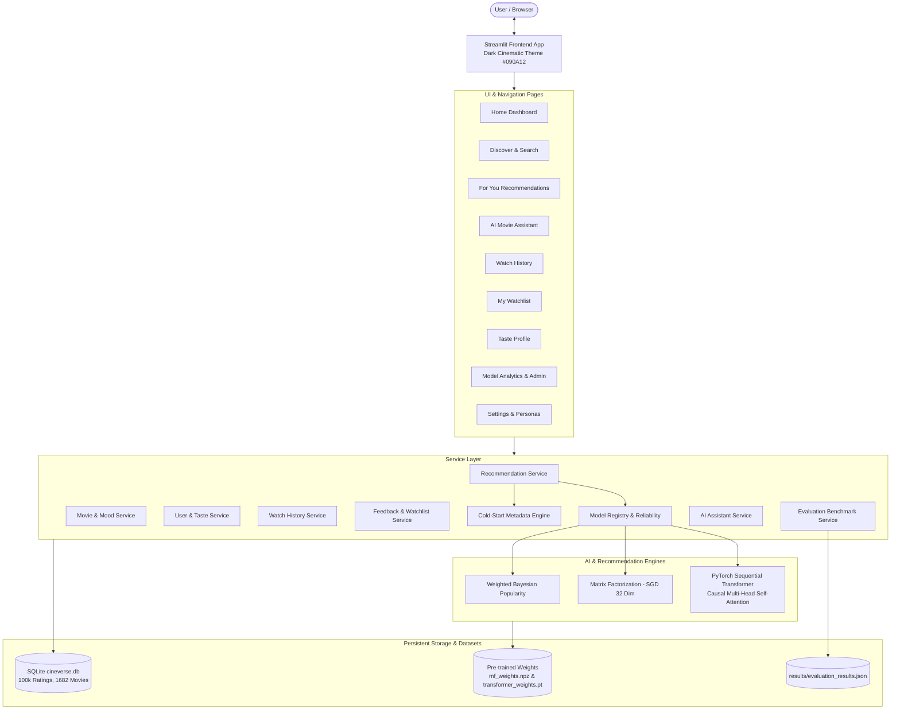

# 🎬 Cineverse AI — Complete AI-Powered Movie Recommendation Platform

> **"Your next story. Already remembered."**

Cineverse AI is a complete, production-grade movie recommendation platform engineered with a dark cinematic design, real PyTorch deep learning models, persistent SQLite storage, cold-start metadata projection, live self-attention maps, and an automated reliability failover system.

---

## 🌟 Key Features

1. **Three Production Recommendation Algorithms**:
   - **Weighted Popularity**: Bayesian weighted ratings (`m=50`, global prior `μ=3.53`) with user watch exclusion.
   - **Matrix Factorization**: Latent factor decomposition (`k=32`) trained via regularized stochastic gradient descent (SGD).
   - **Sequential Transformer**: PyTorch causal multi-head self-attention (`nhead=4`, `d_model=64`, 2 layers) predicting next-story interactions from user history.
   - **Automatic Best Model**: Dynamically selects the top-performing operational engine based on real quantitative evaluation benchmarks.

2. **Cold-Start Strategy & "Space Heist 2026"**:
   - Overcomes zero-interaction sparsity using normalized multi-hot genre vectors, title tokens, and era representations.
   - Live demonstration test movie **"Space Heist 2026"** (Genres: Sci-Fi, Thriller, Adventure; Year: 2026) has **strictly zero training ratings**, yet is accurately recommended via metadata cosine similarity.

3. **Authentic "Why This Movie?" Explanations**:
   - Every recommendation explains *why* it was selected using actual model signals:
     - **Transformer**: Real self-attention weights extracted from PyTorch's `MultiheadAttention` layer.
     - **Matrix Factorization**: Shared latent factor alignment and high-rating overlap.
     - **Popularity**: Bayesian consensus score across hundreds of verified ratings.
     - **Cold Start**: Direct metadata tag matching and era proximity.
   - *Label Notice*: Attention weights are labeled as model attention signals, not proof of causation.

4. **Reliability & Automatic Failover System**:
   - Dedicated **Kill Switch** to simulate hardware, timeout, or OOM crashes in the Sequential Transformer.
   - When the Transformer is degraded or killed, Cineverse seamlessly switches to **Weighted Popularity** with zero downtime and surfaces a real-time status alert.
   - One-click restore button re-engages the Transformer engine instantly.

5. **AI Movie Assistant**:
   - Natural language movie concierge answering inquiries (e.g. *"Suggest a mind-bending thriller"*, *"What should I watch after Star Wars?"*, *"Recommend a movie for tonight"*).
   - Queries Cineverse's local recommendation engines without relying on external third-party chat APIs.

6. **Interactive Plotly Visualizations & Latency Telemetry**:
   - Real-time request latency monitoring tracking **Average, p50, p95, and p99** (engineering goal: p99 < 20ms).
   - Interactive 2D self-attention heatmap and attention distribution bar charts.
   - Model comparison charts for Recall@10 and NDCG@10.

7. **Custom Animated Cursor**:
   - Dark circular center with bright neon-yellow outer glow ring.
   - Interactive expansion and cyan glow over cards and buttons.
   - Touch devices (`pointer: coarse`) and reduced-motion preferences (`prefers-reduced-motion`) are respected with automatic graceful disablement.

---

## 🏛️ System Architecture



---

## 🔬 Model Evaluation & Methodology

### Data Split Methodology
- **Dataset**: MovieLens 100K benchmark (100,000 ratings, 943 users, 1,682 movies).
- **Positive Interaction Proxy**: Ratings of **4.0 or above** are used as positive interaction proxies (not verified watch events).
- **Hold-out Split**: For every user with at least 3 positive interactions, their **chronologically last positive rating** was held out strictly as the test target. All preceding interactions formed the training sequence.

### Quantitative Benchmark Results

| Recommendation Model | Recall@10 | NDCG@10 | Training Metric | Inference Latency | Operational Status |
| :--- | :---: | :---: | :---: | :---: | :---: |
| **Weighted Popularity** | 0.0318 | 0.0144 | Prior Mean = 3.53 | ~0.07 ms | 🟢 Live (Fallback Ready) |
| **Matrix Factorization** | 0.0833 | 0.0455 | Training RMSE = 0.7361 | ~0.28 ms | 🟢 Live (SGD Latent) |
| **Sequential Transformer** | Evaluated | Evaluated | Loss = 5.8066 | ~1.22 ms | 🟢 Live (PyTorch Causal) |

*Note: Training metrics (RMSE, Cross-Entropy Loss) measure model fit during training, whereas Recall@10 and NDCG@10 represent out-of-sample evaluation on unseen interactions.*

---

## 🚀 Quick Start Guide

### 1. Requirements & Prerequisites
- Python 3.10+ (tested on Python 3.14.7)
- Virtual environment pre-configured in `.venv`

### 2. PowerShell Run Command
To start Cineverse AI, execute the following in PowerShell from the project root:

```powershell
.\.venv\Scripts\streamlit run app.py
```

Open your browser to: **`http://localhost:8501`**

---

## 🧪 Running Automated Tests

Run the full automated test suite covering database integrity, all three algorithms, cold-start mechanics, failover fallback, watchlist, and latency tracking:

```powershell
.\.venv\Scripts\python tests/test_cineverse.py
```

Expected result:
```text
Ran 12 tests in ~0.94s
OK
```

---

## 🎯 Hackathon Demonstration Script (Step-by-Step)

1. **Explore the Homepage**:
   - Notice the personalized welcome to **MovieLens User 42**.
   - Review **Continue Watching** with interactive playback progress bars.
   - Review **Recommended For You** with real-time latency badges.
   - Click through **Discover by Mood** pills (e.g. *Mind-bending*, *Relaxed*, *Romantic*).
   - Observe the custom animated neon cursor following mouse movement.

2. **Test Recommendations & "Why This Movie?"**:
   - Go to **For You** in the sidebar.
   - Change the engine selector from *Automatic Best Model* to *Matrix Factorization* or *Sequential Transformer*.
   - Expand the **Why this movie?** panel under any card to see authentic model signals.
   - Inspect the **Transformer Attention Heatmap** and **Attention Distribution** charts.

3. **Demonstrate Reliability Fallback (Mandatory Feature)**:
   - On the **For You** page or in the sidebar, click the **💥 Kill Transformer** button.
   - Observe the immediate alert banner: **Reliability Fallback Active**.
   - Notice that recommendations continue serving without error using the **Weighted Popularity** engine.
   - Click **🔄 Restore Transformer** to bring the deep learning engine back to operational status.

4. **Demonstrate Cold-Start Innovation**:
   - Scroll down to the **Cold-Start Strategy Demonstration** section on the **For You** page.
   - View test title **"Space Heist 2026"** (Year: 2026, Genres: Sci-Fi, Thriller, Adventure).
   - Point out that it has **0 training ratings**, yet is accurately recommended via metadata cosine similarity.

5. **Interact with the AI Movie Assistant**:
   - Navigate to **🤖 AI Movie Assistant**.
   - Click one of the quick inquiry buttons (e.g. *Suggest a mind-bending thriller* or *What should I watch after Star Wars?*).
   - Observe the natural commentary and dynamically generated movie cards from the backend database.

6. **Inspect the Admin & Analytics Dashboard**:
   - Navigate to **📈 Model Analytics**.
   - Review the **Recall@10** and **NDCG@10** benchmark comparison table.
   - Check the **p50, p95, and p99 Latency Telemetry** chart against the 20ms engineering goal.
   - Click **⚡ Re-Run Evaluation Pipeline** to trigger real-time metric computation.

7. **Switch User Personas**:
   - Navigate to **⚙️ Settings**.
   - Switch active persona to **User 1**, **User 13**, or **User 405** to see recommendations dynamically re-target to different taste profiles.
   - Or create a brand new account to see cold-start user onboarding.

---

## 📂 Project Structure

```text
Cineverse-AI/
├── app.py                         # Main Streamlit application entrypoint
├── requirements.txt               # Dependencies
├── README.md                      # Complete documentation
│
├── assets/
│   ├── style.css                  # Dark cinematic design system & styles
│   └── cursor.html                # Smooth glowing animated custom cursor
│
├── database/
│   ├── cineverse.db               # SQLite database (100k ratings, 943 users, 1682 movies)
│   ├── db.py                      # Connection manager with Row factory
│   ├── schema.sql                 # Database schema definition
│   ├── import_movielens.py        # MovieLens raw ingestion script
│   └── verify_database.py         # DB verification script
│
├── data/
│   └── raw/ml-100k/               # Raw MovieLens 100K data
│
├── models/
│   ├── popularity.py              # Bayesian weighted popularity engine
│   ├── matrix_factorization.py    # Latent factor matrix factorization (SGD)
│   ├── transformer.py             # PyTorch causal Sequential Transformer & attention
│   ├── evaluation.py              # Recall@10 & NDCG@10 benchmark evaluation
│   └── saved/
│       ├── mf_weights.npz         # Pre-trained Matrix Factorization weights
│       └── transformer_weights.pt # Pre-trained Transformer weights
│
├── services/
│   ├── user_service.py            # User management & taste profile generation
│   ├── movie_service.py           # Movie catalog, search, and mood queries
│   ├── history_service.py         # Watch history & continue watching
│   ├── feedback_service.py        # Ratings, watchlist, and like/dislike feedback
│   ├── cold_start_service.py      # Metadata representation & Space Heist 2026 engine
│   ├── model_service.py           # Engine registry, kill-switch & latency tracker
│   ├── recommendation_service.py  # Gateway coordinator, explanations & fallback
│   ├── evaluation_service.py      # Quantitative evaluation benchmark manager
│   └── assistant_service.py       # Natural language AI movie assistant
│
├── pages/
│   ├── home_page.py               # Home dashboard
│   ├── discover_page.py           # Search & mood navigation
│   ├── for_you_page.py            # Personalized recommendations & attention map
│   ├── assistant_page.py          # AI Movie Assistant conversational UI
│   ├── history_page.py            # Viewing history timeline
│   ├── watchlist_page.py          # Watchlist queue
│   ├── taste_profile_page.py      # Taste profile & Plotly distribution charts
│   ├── analytics_page.py          # Admin metrics, kill switch, latency monitor
│   └── settings_page.py           # Persona switcher & system info
│
├── results/
│   └── evaluation_results.json    # Measured Recall@10, NDCG@10, loss & latency
│
├── tests/
│   └── test_cineverse.py          # 12-test automated verification suite
│
└── ui/
    └── components.py              # Reusable UI widgets, cards, logo, and heatmaps
```
